# Архитектура Hermes (вариант B)

Версия 15.10.2026. Основание: ADR «Вариант B» в `docs/decisions.md`, исследование в
`docs/OPEN_SOURCE_RESEARCH.md`, требования к оболочке — мастер-промт. Ориентир по Hermes Agent:
**v0.22.x (релизы 14–15.10.2026)**; при реализации бутстрапа версию закрепить (commit pin).

## 1. Схема компонентов

Исходник: `diagrams/architecture_01_flowchart_components.mmd`.

Что важно понимать:
- **Три процесса, один установщик.** Наше приложение (Tauri) — окно и «администратор»; Hermes Agent —
  мозг и руки; Ollama — локальные модели. Второй и третий ставятся и обновляются нашим приложением,
  пользователь их не видит.
- **Вход в Hermes один** — локальный `api_server` на loopback с Bearer-ключом, который генерирует и
  хранит наше приложение. Снаружи к ПК никто не подключается.
- **Опасные действия проходят две проверки**: наш плагин внутри Hermes (уровень инструмента) и политика
  одобрений Hermes (опасные команды, запреты, граница записи). Подтверждение показывает наш UI.
- **Данные не уходят в облако без выбора**: модель по умолчанию локальная, облачные провайдеры включаются
  явно в настройках, fallback — только с согласия.

## 2. Компоненты и ответственность

| Компонент | Технология | Отвечает за | Не отвечает за |
|---|---|---|---|
| **Оболочка: UI** | React 19 + TS, Vite, Tailwind, shadcn/ui, Zustand, TanStack Query | экраны Chat, Approvals, Voice, Status, Settings, Setup-мастер; стриминг и отображение шагов инструментов; окно подтверждения; индикаторы записи/воспроизведения | логику агента, выполнение инструментов |
| **Оболочка: Rust** | Tauri 2.12, tokio, reqwest (SSE), keyring, cpal/rodio, tauri-plugin-global-shortcut/autostart/single-instance/updater | супервизор процессов (gateway Hermes, `ollama serve`), бутстрап и обновление Hermes по стадийному протоколу, генерация `config.yaml`/`.env`, секреты в Credential Manager, захват микрофона и воспроизведение, глобальная горячая клавиша, трей, оверлей | хранение диалогов (это в Hermes) |
| **Hermes Agent** | Python 3.14 в `%LOCALAPPDATA%\hermes` (uv), gateway как задача Планировщика | цикл инструментов, сессии и память (SQLite Hermes), skills, cron, провайдеры моделей, одобрения, терминал/файлы/computer-use/браузер, STT/TTS-движки, Telegram и другие каналы, MCP | UI |
| **Плагин `hermes_permissions`** | Python-плагин Hermes, хук `pre_tool_call` | уровни Read-only / Normal / Confirm / Blocked по инструменту и аргументам; `block` / `approve` / `modify`; fail-closed | подмену встроенных проверок Hermes (они остаются) |
| **Ollama** | сайдкар из `ollama-windows-amd64.zip`, `OLLAMA_MODELS=D:\hermes\models`, порт 11434 | локальный инференс на RTX 3080 Ti, загрузка моделей с прогрессом | — |
| **Провайдеры по сети** | OpenAI-совместимый Jarvis Deka; Anthropic/OpenAI/Gemini | по явному выбору пользователя | — |

## 3. Потоки

### 3.1 Текстовая задача
1. UI → Rust → `POST /v1/runs {input, session_id}` → Hermes.
2. Rust читает `GET /v1/runs/{id}/events` (SSE) и ретранслирует UI события: токены, reasoning,
   `hermes.tool.progress`, `approval.request`, `run.completed/failed/cancelled/interrupted`.
3. Стоп — `POST /v1/runs/{id}/stop`. История — Sessions API Hermes.

### 3.2 Подтверждение
1. Hermes (встроенная проверка или наш плагин) публикует `approval.request` с вариантами
   once / session / always / deny (набор может быть сужен для опасных команд).
2. UI показывает команду/инструмент и аргументы; таймаут Hermes по умолчанию 300 с → отказ.
3. Ответ — `POST /v1/runs/{id}/approval`. Run продолжается или получает `BLOCKED: …`.

### 3.3 Голос (MVP — push-to-talk)
1. Глобальная горячая клавиша → Rust пишет микрофон (cpal), индикатор в UI и оверлее.
2. Отпускание → аудио → эндпоинт транскрипции Hermes (Faster-Whisper, `stt.language: ru`) →
   текст → как в 3.1.
3. Ответ → TTS Hermes (Piper ru) → воспроизведение в оболочке; новая запись или ввод текста
   прерывает воспроизведение. Точные пути голосовых эндпоинтов api_server проверить по коду
   Hermes перед реализацией (`/api/audio/transcribe`, `/api/audio/voice-config`, speech WebSocket).

### 3.4 Первый запуск (мастер)
1. Проверка: ОС ≥ Win11 22H2, WebView2, GPU/драйвер NVIDIA, свободное место на D:.
2. Согласие пользователя на скачивание: окружение Hermes (~1 ГБ), Ollama (~0,5 ГБ), модели
   (LLM ~6 ГБ, Faster-Whisper, Piper ru).
3. Бутстрап Hermes: `install.ps1 -Manifest` → список стадий → `-Stage NAME -NonInteractive -Json`
   по очереди с прогрессом (образец — `apps/bootstrap-installer` Hermes, Tauri, MIT); pin commit.
4. Генерация `config.yaml` (провайдер Ollama, `approvals.mode: manual`, `approvals.deny`,
   `HERMES_WRITE_SAFE_ROOT`, toolsets, `stt.language: ru`, `tts.provider: piper`), `.env`
   (`API_SERVER_KEY` из Credential Manager), установка плагина `hermes_permissions` и skills.
5. Распаковка Ollama, `ollama serve`, `ollama pull` модели с прогрессом.
6. `hermes gateway install/start`, проверка `/health` и `/v1/capabilities` → экран Status зелёный.

## 4. Хранение и секреты

| Что | Где |
|---|---|
| Диалоги, сессии, память, журнал одобрений | SQLite Hermes (`%LOCALAPPDATA%\hermes`) |
| Настройки оболочки (окно, горячая клавиша, устройства, тема) | JSON/SQLite в `%APPDATA%\Hermes` |
| `API_SERVER_KEY`, ключи облачных провайдеров | Windows Credential Manager (`keyring`); Hermes читает ключи из своего `.env`, который пишет наш Rust |
| Модели | `D:\hermes\models` (Ollama), кэш Hermes для STT/TTS |
| Логи | `%LOCALAPPDATA%\ua.koavart.hermes\logs` (оболочка), `%LOCALAPPDATA%\hermes\logs` (Hermes) |

## 5. Безопасность

- Tauri: минимальные capabilities, строгий CSP, команды только из `src-tauri/src/commands/`.
- Hermes: `approvals.mode: manual`, никаких `--yolo`/`off`; `approvals.deny` для своих запретов
  (выключение ПК, удаление вне рабочих папок, изменение системных настроек); `HERMES_WRITE_SAFE_ROOT`.
- Плагин разрешений fail-closed: таймаут или исключение = блокировка.
- Страницы, файлы и результаты инструментов — недоверенные данные (Hermes сканирует контекстные файлы,
  website blocklist, SSRF-защита); наш UI не исполняет ничего из ответов модели.
- Ключи не попадают в логи; Hermes вырезает `*KEY*`/`*TOKEN*`/`*SECRET*` из окружения инструментов.

## 6. Сборка и поставка

- Разработка на Linux (Linux-сборка Tauri для UI, `cargo test`, vitest). Windows-сборка — GitHub Actions
  `tauri-action` на windows-latest по тегу `v*` → NSIS/MSI в Release.
- В бандле: приложение, скрипт бутстрапа Hermes (pin), `ollama-windows-amd64.zip` (или скачивание
  в мастере), плагин и skills. Модели — только скачиванием с согласия.
- Обновления: оболочка — tauri-plugin-updater; Hermes — стадийный протокол повторно с новым pin.
- macOS: позже, на Mac mini M4 (Hermes там уже стоит).

## 7. Отклонения от мастер-промта (осознанные)

| Промт | У нас | Почему |
|---|---|---|
| §2.4/§7 Agent Runtime на Rust | Hermes Agent (Python) | готовое, проверенное, 100+ контрибьюторов |
| §9 Playwright | browser tool Hermes (Chromium/CDP) | нет Rust-биндинга Playwright; функционал тот же |
| §11 LocalModelService над Ollama | Ollama как сайдкар, управляется Rust; инференс через провайдер Hermes | Hermes уже умеет Ollama |
| §14 SQLite с репозиториями | SQLite Hermes для данных агента; наша — только настройки | не дублировать хранилища |
| §12 Integration SDK | plugins/skills/MCP/каналы Hermes | шире промта |
