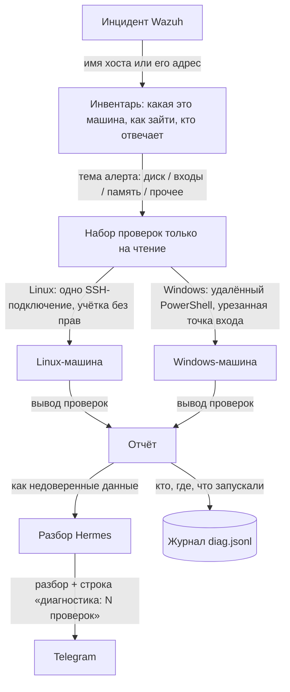

# Инвентарь и диагностика на машинах (этап 9, шаг 3)

Починка (действия с изменениями) — отдельно, `docs/FIX.md`.

Перед разбором алерта Wazuh служба `hermesd` находит хост в инвентаре и сама запускает
на нём проверки только на чтение. Их вывод передаётся модели вместе с алертом.
**Модель команды не выполняет и не выбирает:** набор проверок задан в коде
(`crates/hermes-core/src/diag.rs`), а какие из них запускать, решает правило по теме алерта.
Решение — ADR 18.10.2026.

## Путь данных



- На машинах заведена отдельная учётка без права что-либо менять: на Linux — пользователь без
  sudo в группах чтения журнала, на Windows — точка входа JEA с белым списком команд чтения.
- Ключ SSH принимается только с адреса сервера Hermes, без проброса портов и без терминала.
- Каждый запуск пишется в журнал: хост, проверки, длительность, ошибка. На Windows JEA ещё и
  ведёт свою стенограмму сеанса.
- Хост не из инвентаря или с `access: none` разбирается только по алерту.

## Каталог проверок

| ОС | id | Что смотрит |
|---|---|---|
| Linux | `uptime` | `uptime; free -m` |
| Linux | `disk` | `df -hP`, `df -iP` (без tmpfs/overlay) |
| Linux | `disk_top` | `du -xhd1` по /var, /var/log, /home, /tmp, /opt |
| Linux | `procs` | 15 процессов с наибольшей загрузкой CPU |
| Linux | `failed_units` | `systemctl --failed` |
| Linux | `journal_errors` | `journalctl -p err --since=-1h` |
| Linux | `auth_log` | журнал ssh/sshd за час, `last -n 10` |
| Linux | `oom` | сообщения ядра об OOM за 6 часов |
| Linux | `net` | `ss -s`, слушающие порты |
| Windows | `uptime` | время загрузки и память (Win32_OperatingSystem) |
| Windows | `disk` | место на дисках (Win32_LogicalDisk) |
| Windows | `services` | автоматические службы не в работе |
| Windows | `events` | ошибки System/Application за час |
| Windows | `procs` | 15 процессов с наибольшей загрузкой CPU |
| Windows | `auth` | неудачные входы (4625) и блокировки (4740) за час |

Какие проверки запускаются:
- **Linux, всегда:** `uptime`, `disk`, `failed_units`, `journal_errors`.
- **Linux, по теме алерта:** диск → `disk_top`; входы → `auth_log`; память → `oom` и `procs`;
  сеть → `net`; прочие темы → `procs`.
- **Windows, всегда:** `uptime`, `disk`, `services`, `events`.
- **Windows, по теме алерта:** входы → `auth`; прочие темы → `procs`.

Каждая проверка на Linux ограничена 20 секундами, всё SSH-подключение — 90 секундами.
Каждая проверка на Windows ограничена 45 секундами. Вывод одной проверки обрезается до 3000 символов.

## Инвентарь

`C:\ProgramData\Hermes Assistant Server\ua.koavart.hermes\inventory.json`, правится через
`hermesctl inventory-put <file>` (адреса и имена проверяются, дубли отклоняются):

```json
{
  "hosts": [
    { "name": "web-01", "aliases": ["web-01.deka.local"], "address": "10.0.0.5",
      "os": "linux", "access": "ssh", "owner": "Иван (веб)", "criticality": "high",
      "notes": "nginx + php-fpm, бэкапы в 03:00" },
    { "name": "dc-01", "os": "windows", "access": "winrm", "owner": "IT", "criticality": "high" }
  ]
}
```

| Поле | По умолчанию | Что значит |
|---|---|---|
| `name` | — | `agent.name` в Wazuh |
| `aliases` | `[]` | другие имена; `web-01.deka.local` и так находит `web-01` |
| `address` | `name` | куда подключаться (для WinRM — имя, не IP: нужен Kerberos) |
| `os` | `linux` | `linux` / `windows` |
| `access` | `none` | `ssh` / `winrm` / `none` |
| `user`, `port` | `hermes-diag`, `22` | для SSH |
| `winrm_configuration` | `HermesDiag` | имя точки входа JEA |
| `owner`, `criticality`, `notes` | — | попадают в разбор |

## Подготовка машин

### Linux

```bash
tools/hermesctl.sh diag-key                       # открытый ключ службы (создаётся при первом запросе)
# на машине, под root:
sudo bash tools/diag/linux-setup.sh 'ssh-ed25519 AAAA… hermes-diag@SERVER' <IP сервера Hermes>
tools/hermesctl.sh diag-run web-01                # проверка: те же проверки, что для алерта
```

Скрипт создаёт пользователя `hermes-diag`: без пароля и sudo, в группах `systemd-journal` и `adm`.
Ключ в `authorized_keys` ограничен опциями `from="<сервер>",no-port-forwarding,no-agent-forwarding,no-X11-forwarding,no-pty`.
Ключ хоста при первом подключении запоминается в `…\ssh\known_hosts`. Если он потом сменится,
подключения не будет, пока старую строку не удалят.

### Windows (домен)

```powershell
# на каждой машине под администратором (или GPO/DSC), из папки tools\diag:
.\windows-setup.ps1 -Principal 'DEKA\HERMES-SRV$'    # учётка компьютера, если служба под NT SERVICE\HermesAssistant
.\windows-setup.ps1 -Principal 'DEKA\svc-hermes'     # если служба под доменной учёткой
```

Регистрирует точку входа JEA `HermesDiag` (`HermesDiag.psrc`): видны только `Get-CimInstance`
(классы ОС, дисков и служб), `Get-WinEvent`, `Get-Process`, `Get-Service`, `Select-Object`,
`Sort-Object`, `Measure-Object`. Режим NoLanguage, стенограммы пишутся в
`C:\ProgramData\JEA\Transcripts\HermesDiag`. При регистрации WinRM перезапускается.

## Control API

| Маршрут | Что делает |
|---|---|
| `GET/PUT /inventory` | инвентарь |
| `GET /diag/probes` | каталог проверок |
| `GET /diag/ssh-key` | открытый ключ службы (создаёт при первом вызове) |
| `POST /diag/run {host, probes?}` | запустить проверки вручную; без `probes` — базовый набор |

## Проверено (19.10.2026)

- **Linux по SSH:** вживую через временный sshd. Ключ службы, одно подключение, 5 проверок за
  1,2 с, разбор вывода, запись в журнал. Опасный адрес (`-oProxyCommand=…`) и неизвестная
  проверка отклоняются.
- **Windows (WinRM/JEA):** проверено только unit-тестами (сборка команды). Нужен прогон на
  машине в домене.
