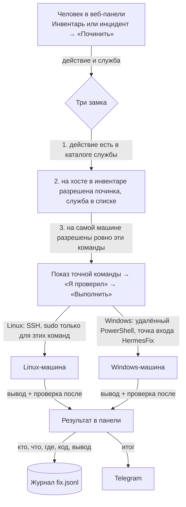

# Починка из веб-панели (этап 9, шаг 4)

Человек в веб-панели сервера (`docs/SERVER.md`) выбирает действие из короткого каталога,
видит точную команду и хост, подтверждает. Служба выполняет команду, сразу запускает
проверку и показывает результат. Модель ничего не чинит сама. Решение — ADR 18.10.2026.

## Путь данных

- Алерты безопасности не чинятся: для такого инцидента сервер отказывает, а в панели
  кнопки нет.
- На одном хосте одновременно идёт только одна починка.
- Без подтверждения (`confirm: true`) сервер команду не выполнит.

## Каталог действий

| ОС | id | Команда | Проверка после |
|---|---|---|---|
| Linux | `restart_service` | `sudo -n /usr/bin/systemctl restart <служба>` + `systemctl status` | `failed_units` |
| Linux | `vacuum_journal` | `sudo -n /usr/bin/journalctl --vacuum-size=500M` | `disk` |
| Linux | `rotate_logs` | `sudo -n /usr/sbin/logrotate -f /etc/logrotate.conf` | `disk` |
| Windows | `restart_service` | `Restart-Service -Name <служба>` (точка входа HermesFix) | `services` |
| Windows | `start_service` | `Start-Service -Name <служба>` (точка входа HermesFix) | `services` |

Каталог задан в коде (`crates/hermes-core/src/fix.rs`). Новое действие появляется только с
новой версией.

## Как разрешить починку на машине

1. **Инвентарь (панель → Инвентарь → изменить хост):** включить «Разрешить починку из панели»
   и перечислить службы, которые можно перезапускать.
2. **На самой машине:**
   - Linux, под root:
     `sudo bash tools/diag/linux-setup.sh '<ключ>' <IP сервера> --fix "nginx php8.2-fpm"`.
     Скрипт создаёт `/etc/sudoers.d/hermes-diag` ровно с этими командами и проверяет его
     через `visudo -c`. Повторный запуск без `--fix` удаляет правила.
   - Windows, под администратором:
     `.\windows-setup.ps1 -Principal 'DEKA\<сервер>$' -FixServices W3SVC,Spooler`.
     Создаёт точку входа JEA `HermesFix`, где видны только `Restart-Service` и `Start-Service`
     для перечисленных служб (ValidateSet). Стенограммы пишутся в
     `C:\ProgramData\JEA\Transcripts\HermesFix`.

Если хоть один замок закрыт, починки не будет. Если машина не подготовлена, `sudo -n` сразу
вернёт «interactive authentication is required», а JEA откажет в команде. Панель покажет
ошибку, журнал её запишет.

## Control API

| Маршрут | Что делает |
|---|---|
| `GET /fix/actions` | каталог действий |
| `POST /fix/preview {host, action, service?, incident_id?}` | проверка замков и точная команда, ничего не выполняет |
| `POST /fix/run {…, confirm: true}` | выполнить; ответ — вывод, код и проверка после |

## Проверено (19.10.2026)

Вживую против временного sshd:
- предпросмотр команды;
- отказ для службы не из списка, без подтверждения и для инцидента безопасности;
- реальный запуск по SSH дошёл до `sudo -n` и получил отказ (правил на тестовой машине нет),
  после чего прошла проверка `failed_units` и появилась запись в `fix.jsonl`;
- диалог в панели проверен в браузере.

Не проверено: успешный перезапуск службы с настроенным sudoers и вся сторона Windows (JEA HermesFix).
