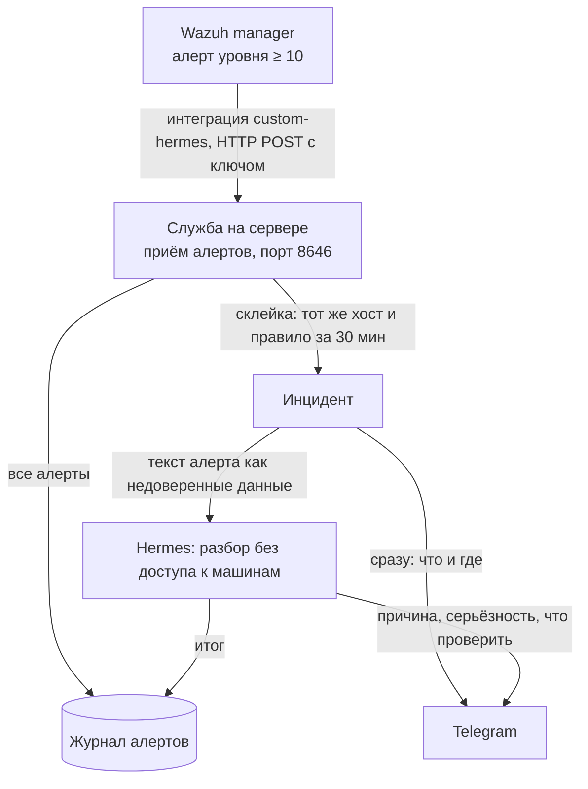

# Алерты Wazuh → Hermes (этап 9, шаг 2)

Служба `hermesd` на Windows Server (`docs/SERVER.md`) принимает алерты от Wazuh manager,
склеивает их в инциденты, сразу шлёт карточку в Telegram и просит Hermes написать разбор.
Решение — ADR 18.10.2026 (`docs/decisions.md`).

## Путь данных



- Наружу открыт только приём алертов: один адрес, ключ и белый список IP (адрес manager'а).
  Control API остаётся на `127.0.0.1`.
- Шторм из сотни одинаковых алертов превращается в один инцидент. В Telegram дополнительно
  приходит строка на 10-м, 100-м и 1000-м повторе.
- Модель сама ничего не выполняет: все её запросы на команды служба отклоняет. Если хост
  есть в инвентаре, служба перед разбором сама запускает проверки только на чтение из
  фиксированного списка и передаёт их вывод модели (`docs/DIAG.md`).
- Алерты безопасности (подбор паролей, атаки, rootcheck/syscheck, уязвимости, MITRE)
  помечаются отдельно и не чинятся никогда: разбор заканчивается эскалацией людям.
- Не больше 20 разборов в час (`max_analyses_per_hour`). Сверх лимита приходит только карточка.

## Настройка

### 1. Служба (Windows Server)

```bash
export HERMES_TARGET=server HERMES_PC=<сервер>
tools/hermesctl.sh wazuh-config > /tmp/w.json      # значения по умолчанию
# в /tmp/w.json: "enabled": true, "allowed_ips": ["<IP Wazuh manager>"]
tools/hermesctl.sh wazuh-config-put /tmp/w.json    # ответ restart_required: true
# перезапустить службу: Restart-Service HermesAssistant (на сервере, под администратором)
tools/hermesctl.sh key-set TELEGRAM_BOT_TOKEN <токен бота>
tools/hermesctl.sh key-set TELEGRAM_CHAT_ID <id чата для алертов>
tools/hermesctl.sh wazuh-integration               # готовый блок для ossec.conf
```

Ещё нужно открыть в брандмауэре Windows входящий TCP 8646 только с адреса manager'а
(под администратором):

```powershell
New-NetFirewallRule -DisplayName "Hermes Wazuh ingest" -Direction Inbound -Protocol TCP -LocalPort 8646 -RemoteAddress <IP Wazuh manager> -Action Allow
```

Поля `config.json` (`C:\ProgramData\Hermes Assistant Server\ua.koavart.hermes\wazuh\`):

| Поле | По умолчанию | Что значит |
|---|---|---|
| `enabled` | `false` | включить приём (после смены — перезапуск службы) |
| `listen` | `0.0.0.0:8646` | адрес приёма |
| `allowed_ips` | `[]` | с каких адресов принимать; пусто — с любых (не оставлять так) |
| `min_level` | `10` | ниже этого уровня алерт только сохраняется |
| `ignore_rules` | `[]` | id правил-шума |
| `window_min` | `30` | окно склейки повторов, минут |
| `analyze` | `true` | просить разбор у Hermes |
| `max_analyses_per_hour` | `20` | лимит разборов в час |
| `telegram` | `true` | слать в Telegram |
| `telegram_chat_id` | `""` | чат для алертов; пусто — `TELEGRAM_CHAT_ID` из `.env` |
| `diagnose` | `true` | перед разбором запускать проверки только на чтение на хосте из инвентаря (`docs/DIAG.md`) |

### 2. Wazuh manager (Linux)

```bash
cp tools/wazuh/custom-hermes /var/ossec/integrations/
chown root:wazuh /var/ossec/integrations/custom-hermes
chmod 750 /var/ossec/integrations/custom-hermes
# в /var/ossec/etc/ossec.conf — блок <integration> из wazuh-integration (hook_url: адрес сервера)
systemctl restart wazuh-manager
tail -f /var/ossec/logs/integrations.log                 # ошибки отправки
```

### 3. Проверка без Wazuh

```bash
tools/hermesctl.sh wazuh-test tools/wazuh/sample-alert.json   # → new_incidents: [N]
tools/hermesctl.sh wazuh-incidents                            # состояние разбора: running → done
```

## Control API

| Маршрут | Что делает |
|---|---|
| `GET/PUT /wazuh/config` | настройки (PUT проверяет адреса и отвечает `restart_required`) |
| `GET /wazuh/integration` | ключ приёма и готовый блок `<integration>` для ossec.conf |
| `GET /wazuh/incidents` | последние 200 инцидентов: счётчик, состояние и текст разбора |
| `GET /wazuh/alerts?limit=N` | последние сырые алерты из `alerts.jsonl` |
| `POST /wazuh/alerts` | то же, что приём из сети, но с ключом Control API (тесты, повтор) |

Сеть: `POST /wazuh/v1/alerts` на порту 8646, `Authorization: Bearer <ingest.token>`, тело — один
алерт, массив алертов или `{"alerts": [...]}`, до 1 МБ.

## Дальше

- Шаг 3 (v0.29.0): инвентарь хостов и диагностика только на чтение — `docs/DIAG.md`.
- Шаг 4: починка по кнопке в Telegram (белый список действий, `hermes_permissions`).
- Ждём от Артема: версию Wazuh, объём алертов, разрешение отправлять логи в облачную модель
  (иначе разбор делает Jarvis Deka).
