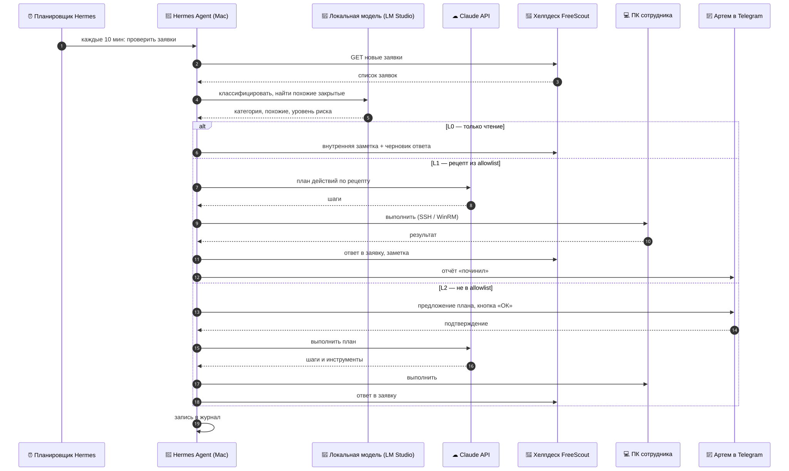

# Персональный ИИ-ассистент: что это, как работает и что нужно

Версия 11.10.2026. Проект `ai-agent`, личный проект Артема. Связанные документы: `CLAUDE.md`
(правила работы в репозитории), `docs/decisions.md` (решения), `docs/models.md` (локальные модели),
`docs/deka-scenarios.md` (фоновые сценарии для Deka).

## 1. Зачем

Нужен помощник, который работает круглосуточно, принимает задачи голосом и сообщениями, сам выполняет
рутину на домашнем компьютере и в рабочих системах компании и отчитывается коротко и по делу.
Он не заменяет Артема в решениях: всё, что может навредить, он делает только после разрешения.

## 2. Функциональная схема: путь данных

Исходник: `diagrams/concept_01_flowchart_data_path.mmd`.

Что важно понимать:
- **Входов три**: голос рядом с помощником, сообщение с телефона и расписание, по которому помощник
  сам проверяет очередь заявок и состояние систем. Всё остальное закрыто.
- **Одна точка принятия решения.** Любая задача проходит через разбор «что просят и насколько это
  опасно». Разрешённые действия идут в работу сразу, остальные ждут ответа Артема.
- **Список разрешённых действий ведётся отдельно** и меняется только человеком. Помощник не может
  расширить себе права сам.
- **Всё записывается в журнал**: что сделано, когда, по чьему разрешению. Журнал первичен,
  отчёт Артему строится из него.
- **Ключи доступа отзываемые.** У помощника свои учётные записи во всех системах; если что-то пошло
  не так, его отключают одним действием, не трогая доступы людей.

## 3. Как это работает технически

### 3.1 Из чего состоит

| Часть | Что это | Где работает |
|---|---|---|
| Ядро | Hermes Agent (Nous Research): цикл инструментов, память, skills, планировщик, gateway к мессенджерам, MCP-клиент | Mac mini M4, постоянно, как сервис launchd |
| Основная модель | Claude по API: ведёт длинные цепочки действий, работает с ПК и серверами | облако |
| Локальная модель | Gemma 4 E4B или Qwen3.5 9B через LM Studio: вспомогательные слоты Hermes, голосовые команды, триаж заявок | Mac mini |
| Голосовой контур | слово-активация → распознавание речи → агент → синтез речи | Mac mini, локально |
| Канал сообщений | Telegram-бот: задачи, подтверждения, отчёты | Mac mini ↔ телефон |
| Инструменты | SSH и PowerShell к Windows-ПК, MCP-сервер экрана на ПК, SSH к Linux-серверу, API хелпдеска, Jira, GitLab, Sentry, read-only kubeconfig | цели по сети |
| Журнал и память | файл журнала действий + встроенная память Hermes | Mac mini, бэкап на сервер |

### 3.2 Разделение моделей

Делим не по «лёгкая или тяжёлая задача», а по риску и длине цепочки инструментов:
- **облако**: всё, что меняет состояние ПК, серверов, заявок; многошаговые задачи;
- **локально**: сжатие контекста, заголовки, скоринг разрешений, роутинг MCP, поиск skills, разбор
  голосовых команд, классификация заявок хелпдеска, офлайн-запасной вариант.

Причина: малые модели ненадёжны в длинных цепочках вызовов инструментов, а цена ошибки на машине с
полным доступом высокая. Экономия на API для лёгких задач невелика. Зато локальная модель даёт
приватность для рабочих данных и низкую задержку для голоса.

### 3.3 Уровни автономности

| Уровень | Что можно | Пример |
|---|---|---|
| L0 | читать, анализировать, писать черновики и заметки | триаж заявок, утренняя сводка, разбор упавшего пайплайна |
| L1 | менять состояние по рецепту из allowlist, с отчётом после | перезапуск службы, очистка диска, перезапуск deployment |
| L2 | всё остальное, только после явного «ОК» в Telegram | удаление файлов, выключение ПК, учётные записи сотрудников |

### 3.4 Пример: заявка в хелпдеске

Исходник: `diagrams/concept_02_sequence_helpdesk.mmd`.

### 3.5 Голосовой контур

1. Слово-активация слушается локально (openWakeWord или Porcupine), микрофон не пишется в облако.
2. Фраза распознаётся локально (whisper-large-v3-turbo через MLX или Parakeet TDT 0.6B, русский есть).
3. Текст уходит в Hermes Agent как обычное сообщение.
4. Ответ озвучивается локально (Silero или Piper, запасной вариант `say` macOS) и дублируется в
   Telegram, если задача длинная.

## 4. Что нужно

### 4.1 Железо

| Что | Состояние |
|---|---|
| Mac mini M4, 16 GB, 512 GB SSD | рассматривается; 16 GB хватает для гибридной схемы, локальная модель только малая. Если ещё не куплен, лучше 24 или 32 GB |
| Микрофон и колонка у Mac | нужен нормальный USB-микрофон или конференц-спикерфон, встроенного в Mac mini нет |
| Windows-ПК Артема | есть; нужны OpenSSH-сервер, Wake-on-LAN, маленький MCP-сервер экрана |
| Linux-сервер | есть; отдельный пользователь для агента |

### 4.2 Программы на Mac

Homebrew, Python 3.12+, Hermes Agent, LM Studio с моделью, whisper/MLX, openWakeWord, Silero или Piper,
Tailscale или VPN-клиент, launchd-сервисы для агента и голосового демона.

### 4.3 Доступы и ключи

| Система | Что нужно | Права |
|---|---|---|
| Telegram | бот-токен, chat_id Артема | только личный чат |
| Claude API | ключ | лимит расходов |
| Windows-ПК | SSH-ключ агента, учётка | администратор, но действия через allowlist |
| Linux-сервер | SSH-ключ агента | отдельный пользователь, sudo по списку |
| Хелпдеск FreeScout | API-ключ на учётку агента | чтение, заметки, ответы |
| Jira | токен на учётку агента | чтение; запись после подтверждения |
| GitLab | токен | чтение репозиториев и пайплайнов, комментарии к MR |
| Sentry | токен | чтение |
| Kubernetes | kubeconfig | read-only плюс отдельная роль на restart выбранных deployment |

Все секреты лежат в Keychain на Mac или в `private/`, в репозиторий не попадают.

### 4.4 Сеть

Mac дома должен видеть ПК, сервер и сеть Deka. Вариант по умолчанию: Tailscale на Mac, ПК и сервере
плюс корпоративный VPN до Deka. Снаружи к Mac никто не подключается, он только исходящий.

### 4.5 От Артема

- подтвердить конфигурацию Mac и микрофон;
- дать способ попадания в сеть Deka;
- разрешить завести сервисные учётки агента в FreeScout, Jira, GitLab;
- назвать 5–10 типов заявок, которые чинить автоматически первыми;
- выбрать имя агента и слово-активацию.

## 5. Этапы

| Этап | Что делаем | Результат |
|---|---|---|
| 1 | Hermes Agent + LM Studio на Mac, Telegram-бот, журнал | агент отвечает в Telegram, локальная модель закрывает вспомогательные слоты |
| 2 | SSH к ПК и серверу, Wake-on-LAN, первые инструменты | «включи ПК, запусти, покажи» из Telegram |
| 3 | Хелпдеск L0: триаж, черновики, утренняя сводка | ежедневная сводка, заметки в заявках |
| 4 | Сторож инфраструктуры в режиме алертов, Sentry, CI | ночные проблемы приходят разобранными |
| 5 | Экран ПК через MCP: скриншот, клик, клавиатура | задачи в графических программах |
| 6 | Голосовой контур | задачи голосом у Mac |
| 7 | L1-автопочинка по allowlist из накопленного журнала | повторяющиеся заявки закрываются сами |
| пауза | умный дом через Home Assistant | после основного |

## 6. Риски и ограничения

- **16 GB памяти**: одновременно локальная модель, голос и, например, сборка Xcode не поместятся;
  тяжёлые задачи по расписанию, модель выгружается на их время.
- **Полный доступ к ПК**: ошибка модели стоит дорого, поэтому allowlist, журнал и подтверждения
  обязательны с первого дня, а не «потом».
- **Рабочие данные в облаке**: тексты заявок и логи Deka обрабатывает локальная модель; в облачную
  модель уходят только задачи, которые Артем разрешил явно.
- **Молодой фреймворк**: Hermes Agent меняется быстро, перед каждым этапом сверяться с документацией.
- **Доступность**: при падении интернета дома агент теряет облачную модель и Deka; локальная модель
  и ПК остаются, голосовые команды продолжают работать.
